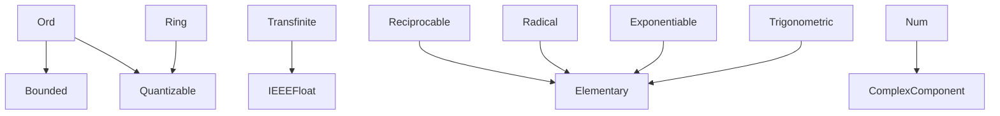
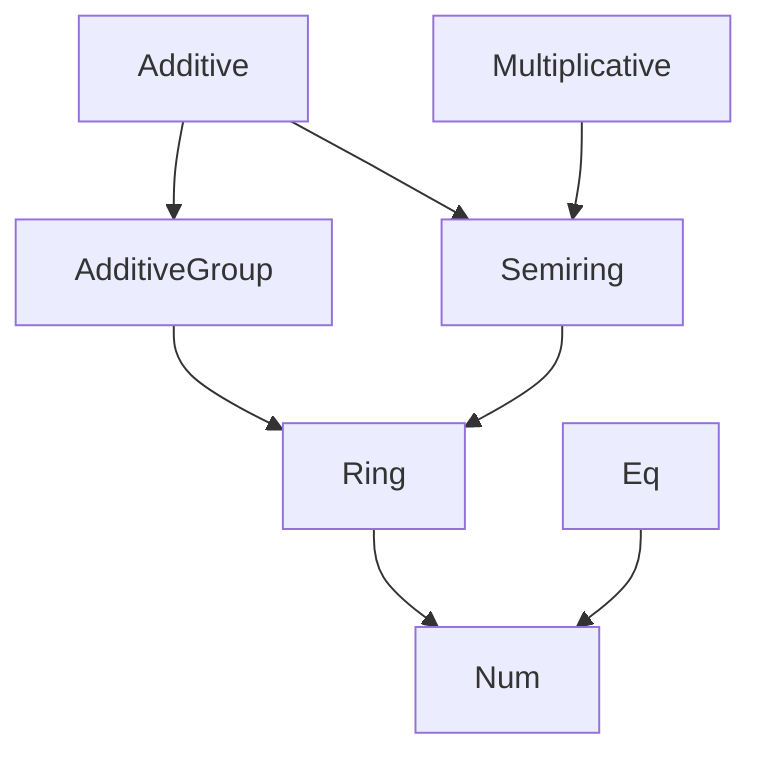
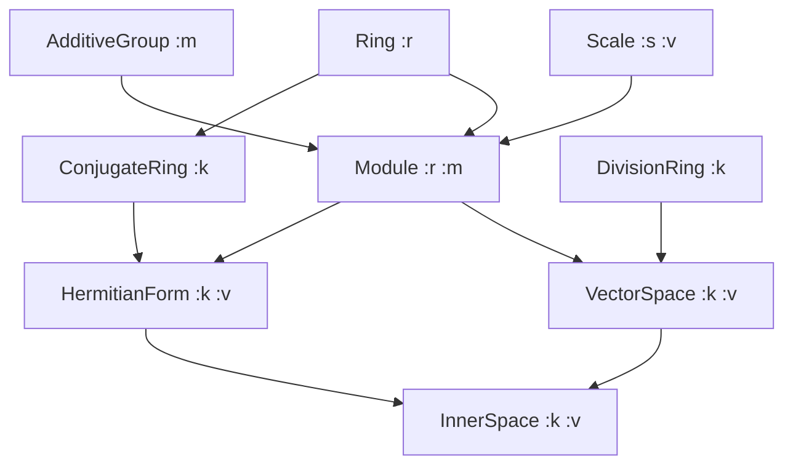
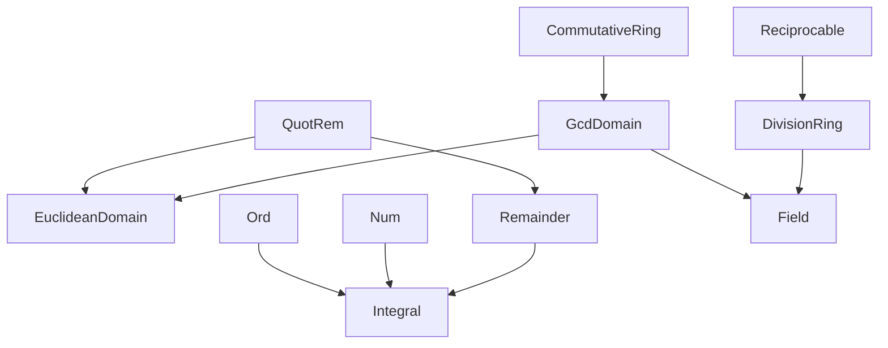

Coalton is statically typed and never performs implicit runtime coercion between
distinct numeric types, yet it supports overloaded numeric literals and fast
native arithmetic on machine types.

This article begins with a practical guide to everyday numbers and arithmetic in
Coalton, followed by a look at the algebraic type classes used for more advanced
mathematical programming.



## Concrete Number Types

Coalton's built-in number types are available in `coalton-prelude` and compile
directly to their underlying Common Lisp representations:

| Type | Description | Overflow / Range |
|---|---|---|
| `Integer` | Arbitrary-precision signed integer | Unbounded (fixnum when small) |
| `I8`, `I16`, `I32`, `I64` | Signed fixed-width integers | Signals an error on overflow |
| `IFix` | Signed machine-sized fixnum | Signals an error on overflow |
| `U8`, `U16`, `U32`, `U64` | Unsigned fixed-width integers | Wraps modulo $2^w$ |
| `UFix` | Unsigned machine-sized fixnum | Wraps |
| `Bit` | Single bit (`0` or `1`) | Wraps modulo $2$ (`+` is XOR, `*` is AND) |
| `Fraction` | Exact reduced ratio of `Integer`s | Unbounded |
| `F32` | IEEE 754 single-precision float | Supports `nan` and `infinity` |
| `F64` | IEEE 754 double-precision float | Supports `nan` and `infinity` |
| `Complex :a` | Complex number with `:a` components | Native `(cl:complex ...)` where supported |

### Literals and Conversions

Integer literals such as `0`, `1`, and `42` are overloaded: they can stand for
any numeric type (`Integer`, `I32`, `F64`, `Fraction`, etc.) as long as the
surrounding code determines which type is needed. When unconstrained by
context, integer literals default to `Integer`. To pin a literal to a specific
type, use [`the`](/manual/operators/the/):

```lisp
(the I32 42)
(the F64 10)
```

Rational literals use Common Lisp ratio syntax (`1/2`, `-3/4`) and always have
type `Fraction`. Floating-point literals follow Common Lisp exponent markers:
`1.0f0` (or `1.0` in standard readtable settings) is `F32`, and `1.0d0` is
`F64`.

Because Coalton does not implicitly cast variables at runtime, mixing variables
of different number types in `+` or `*` is a type error. Instead, convert
explicitly:

- [`as`](/manual/operators/as/) (or `into` from `Into :a :b`): infallible,
  lossless conversion (e.g., `(as Integer (the I32 5))`).
- [`try-as`](/manual/operators/try-as/) (or `try-into` from `TryInto :a :b`):
  checked conversion returning `Result String :b` (e.g., `I64` to `I16`).
- `integral->num` (in `coalton/math/integral`): converts any integer type into
  any numeric type.
- `inexact/` and `fromfrac` (in `coalton/math/real`): converts integer ratios
  or `Fraction`s to floating-point types.

Notice that an expression like `(+ 0.5d0 10)` *does* typecheck without a cast:
`0.5d0` fixes the expression's type to `F64`, so the literal `10` is understood
at compile time as `10.0d0`.

---

## Everyday Arithmetic

For ordinary numerical code, four type classes cover nearly every function
signature you will write:

| Goal | Operations | Class Constraint |
|---|---|---|
| Add, subtract, multiply, use integer literals, test `==` | `+`, `-`, `neg`, `*`, `zero`, `one`, `from-int`, `==` | `Num :a` |
| Divide or take reciprocals | `/`, `recip`, `^^` | `Reciprocable :a` |
| Integer quotients, remainders, parity, bit shifts | `quot`, `rem`, `quotrem`, `div`, `mod`, `divmod`, `to-integer`, `even?`, `odd?`, `lsh`, `rsh` | `Integral :a` |
| Compare values, take absolute values or extrema | `<`, `<=`, `>`, `>=`, `abs`, `min`, `max` | `Ord :a` |

### Negation and Subtraction

Because Coalton functions have fixed arity, `-` is strictly a two-argument
subtraction operator (`(- a b)` computes $a - b$). To negate a single number `x`,
use `(neg x)`:

```lisp
(coalton (neg 5))         ; => -5
(coalton (- 10 3))        ; => 7
```

### Division: `/`, `general/`, `quot`, and `div`

Coalton distinguishes three kinds of division:

1. **Same-type division (`/` and `recip` from `Reciprocable :a`):**
   Divides two values of type `:a` and returns a value of the same type `:a`
   (and `(recip x)` computes `(/ 1 x)`).
   This works on `Fraction`, `F32`, `F64`, and `Complex :a`:
   ```lisp
   (coalton (/ 1.0d0 4.0d0))        ; => 0.25d0
   (coalton (recip (the Fraction 4))) ; => 1/4
   ```
   `Integer` does *not* support `/`, because dividing two integers (like `1` and
   `4`) does not generally produce an integer.
2. **Type-changing division (`general/` from `Dividable :arg :res`):**
   Divides two values of one type to produce a result of another type. For
   instance, `(Dividable Integer Fraction)` lets you divide two `Integer`s to
   get a `Fraction` (or use `exact/` from `coalton/math/real`, which is
   specialized to `Integer * Integer -> Fraction`).
3. **Integer division with remainder (`quot`/`rem` and `div`/`mod`):**
   For integer types (`Integral :a`), you can compute an integer quotient and
   remainder in two ways:
   - `quot` and `rem` truncate the quotient toward zero (matching Common Lisp
     `cl:truncate` and `cl:rem`).
   - `div` and `mod` floor the quotient toward negative infinity (matching
     Common Lisp `cl:floor` and `cl:mod`).
   - `quotrem` and `divmod` return both the quotient and remainder at once as
     multiple values:
     ```lisp
     (let (values q r) = (quotrem -17 5))
     ;; q = -3, r = -2
     (let (values d m) = (divmod -17 5))
     ;; d = -4, m = 3
     ```

### Exponentiation: `^`, `^^`, and `pow`

Coalton provides three exponentiation functions depending on what kind of
exponent you have:

- `(^ base power)`: Raises `base` to a non-negative integer `power` (e.g.,
  `(^ 2 10)` is `1024`, and `(^ 1.5d0 3)` is `3.375d0`).
- `(^^ base power)`: Raises a `Reciprocable` `base` (such as a `Fraction` or
  `F64`) to a signed integer `power`, allowing negative exponents (e.g.,
  `(^^ (the Fraction 2) -3)` is `1/8`).
- `(pow x y)`: Raises `x` to a non-integer power `y` of the same type (e.g.,
  `(pow 2.0d0 0.5d0)`).

### Rounding, Elementary Functions, and Complex Numbers



#### Bounds and Infinities (`coalton/math/bounded`, `coalton/math/arith`)

Fixed-width integers have finite minimum and maximum values, while floating-point
and extended number systems represent infinite and indeterminate values:

- **`Bounded :a`**: types with minimum and maximum bounds (`min-bound`, `max-bound`).
- **`Transfinite :a`**: types with an infinity representation (`infinity`, `negative-infinity`, `infinite?`, `finite?`).
- **`IEEEFloat :a`**: floating-point types supporting IEEE 754 Not-a-Number (`nan`, `nan?`).

`F32`, `F64` and `BigFloat` place NaNs before all other values for sorting
with `<=>` and its derived comparisons. Two NaNs compare `EQ` for ordering,
but `(== nan nan)` is false. Use `nan?` to test for NaN.

#### Rounding and Approximation (`coalton/math/real`)

Real-valued types can be rounded to nearby integers or approximated to a chosen
number of binary digits in another numeric representation:

- **`Quantizable :a`**: rounding finite real values (or an instance's real projection) to `Integer`, e.g. `floor`, `ceiling`, `truncate`, `round`. The mathematical bounds on the result do not require neighboring integers to fit back into `:a`.
- **`Approximable :a :b`**: `(approx bits x)` guarantees *absolute* error at most $2^{-\mathtt{bits}}$, component by component. It signals an error when it cannot certify that bound. For example, no `F32` lies within $1/2$ of the integer $16777217$. Use `from-int`, `fromfrac`, or `big-float:round-to-f32` / `round-to-f64` for ordinary rounded conversion without this guarantee.
- **`Rationalizable :a`**: `(simplest-fraction bits x)` returns a fraction of least positive denominator in the **closed** tolerance interval, breaking ties by least absolute numerator. `simplest-fraction-between` takes two exact rational endpoints. `CReal` supplies an approximation oracle, not decidable endpoint comparisons: use `rational-approx` or `creal:rationalize` for a guaranteed approximation without global minimality.

#### Roots, Exponentials, and Trigonometry (`coalton/math/elementary`)

Elementary transcendental and algebraic functions are grouped by capability so
that types like polynomials, power series, or real algebraic numbers can
implement the subset they support:

- **`Radical :a`**: square roots, $n$th roots and hypotenuses (`sqrt`, `nth-root`, `hypot`).
- **`Exponentiable :a`**: exponentials, logarithms, and hyperbolic functions (e.g., `exp`, `ln`, `pow`, `sinh`, `cosh`).
- **`Trigonometric :a`**: trigonometric and inverse trigonometric functions (e.g., `sin`, `cos`, `tan`, `atan`).
- **`Polar :a`**: polar coordinate conversions (`magnitude`, `phase`, `polar`, `cis`).
- **`Elementary :a`**: mathematical constants `pi` ($\pi$) and `ee` ($e$) on types supporting all elementary operations.

`magnitude` uses the scalar `hypot` method, so it avoids unnecessary overflow
even in polymorphic code. Existing custom `Radical` instances can implement
`hypot` with `canonical-hypot`; existing `Exponentiable` instances can
implement `tanh` and `asinh` with `canonical-tanh` and `canonical-asinh`.
These algebraic formulas suit exact and formal arithmetic; a fixed-precision
type should use its stable numerical kernels instead. Identities for
logarithms, roots and inverse functions assume the appropriate real domain
or complex branch; they are not bitwise identities for rounded numbers.

#### Complex Numbers (`coalton/math/complex`)

Any numeric type implementing `ComplexComponent` can serve as the real and
imaginary parts of `(Complex :a)` (using specialized native Common Lisp complex
representations where available):

- **`ComplexComponent :a`**: types that can form `Complex :a` numbers (constructed with `complex`, destructured with `real-part` and `imag-part`, with imaginary unit `ii`).

---

## Defining Your Own Number Type

You can always implement each algebraic type class in a fine-grained way using
`define-instance` (see [The Algebraic Class Hierarchy](#the-algebraic-class-hierarchy)
below). However, Coalton provides a simple macro, `define-num` (from
`coalton/classes`), for defining routine numerical types that don't need so much
control.

You provide `+`, `-`, `*`, and `from-int` (how to convert an `Integer` into your
type). If you don't specify `zero`, `one`, or `neg`, `define-num` defines
them automatically from `from-int` and `-`:

```lisp
(coalton-toplevel
  (derive Eq)
  (repr :transparent)
  (define-type Mod7
    (Mod7 Integer))

  (declare mod7 (Integer -> Mod7))
  (define (mod7 n)
    (Mod7 (coalton/math:mod n 7)))

  (define-num Mod7
    (define (+ (Mod7 a) (Mod7 b)) (mod7 (+ a b)))
    (define (- (Mod7 a) (Mod7 b)) (mod7 (- a b)))
    (define (* (Mod7 a) (Mod7 b)) (mod7 (* a b)))
    (define (from-int n)           (mod7 n))))
```

If your type has a more direct way to construct `zero` or `one` or to compute
`neg`, you can include `(define zero ...)`, `(define one ...)`, or
`(define (neg x) ...)` inside the `define-num` form as well.

---

## The Algebraic Class Hierarchy

> [!NOTE]
> This section covers slightly more advanced mathematics, drawing primarily on
> concepts from abstract algebra (such as groups, semirings, rings, modules, and
> integral domains). If you are only writing everyday numerical code, the classes
> in [Everyday Arithmetic](#everyday-arithmetic) and `define-num` above are all
> you need.

When writing generic mathematical code—or implementing types like vectors,
matrices, tropical weights, or polynomials that are *not* full rings with
equality—you can constrain functions to the exact algebraic structure they need.

Most of these numerical and algebraic classes carry mathematical laws
(associativity, identity, inverse, distributivity, and so on) that generic
algorithms rely on. When implementing instances for your own types, your
implementations should respect the laws outlined in each class's documentation
in the [Standard Library Reference](/reference/).

### Additive and Multiplicative Classes (`coalton/classes`)



| Class | Methods | Typical Examples |
|---|---|---|
| `Additive :a` | `+`, `zero` | Numbers, vectors, matrices, polynomials |
| `AdditiveGroup :a` | `-`, `neg` | Displacements, vectors, signed numbers |
| `Multiplicative :a` | `*`, `one` | Numbers, square matrices, endomorphisms |
| `Semiring :a` | — | Natural numbers, tropical $(\min, +)$ semiring, polynomials over a semiring |
| `Ring :a` | `from-int` | Integers, matrices, computable reals (`CReal`), formal power series |
| `Num :a` | — | `Integer`, `Fraction`, `F32`, `F64`, `Complex :a`, `Polynomial :a` |

For instance, a 2D vector type only needs `Additive` and `AdditiveGroup` to
support `+`, `-`, `neg`, and `list:sum`—without defining a bogus vector-vector
`*` or `from-int`:

```lisp
(coalton-toplevel
  (derive Eq)
  (define-struct Vec2
    (x F64)
    (y F64))

  (define-instance (Additive Vec2)
    (define (+ (Vec2 x1 y1) (Vec2 x2 y2))
      (Vec2 (+ x1 x2) (+ y1 y2)))
    (define zero (Vec2 0.0d0 0.0d0)))

  (define-instance (AdditiveGroup Vec2)
    (define (- (Vec2 x1 y1) (Vec2 x2 y2))
      (Vec2 (- x1 x2) (- y1 y2)))
    (define (neg (Vec2 x y))
      (Vec2 (neg x) (neg y)))))
```

### Conjugation, Modules, and Inner-Product Spaces (`coalton/math/arith`)

Linear structures where a scalar `:s` acts on a vector or module element `:v`
are expressed with multi-parameter classes in `coalton/math/arith`:



- **`ConjugateRing :a`**:
  A ring with an involutive anti-automorphism `(conjugate x)` (a $\ast$-ring or
  "star ring"). On real types, `conjugate` is the identity; on `Complex :a`,
  it maps $a + bi \mapsto a - bi$.
- **`Scale :s :v`**:
  Left scaling `(scale c v)` of `:v` by `:s`.
- **`Module :r :m`**:
  A module `:m` over a ring `:r`.
- **`VectorSpace :k :v`**:
  Every left module over a `DivisionRing` is automatically a vector space.
  The vector type need not determine a unique scalar field: `Complex Fraction`
  is a vector space over both `Fraction` and `Complex Fraction`.
- **`HermitianForm :k :v`**:
  Provides `(inner-product x y)`, conjugate symmetric and left-linear in `y`.
  The standard coordinate form is $\langle x,y\rangle=\sum_i y_i\overline{x_i}$;
  reversing these factors is not equivalent for quaternion scalars. Where
  several forms exist, annotate the result type to select the scalar field.
- **`InnerSpace :k :v`**:
  A vector space with a nondegenerate Hermitian form: only the zero vector
  is orthogonal to *every* vector. This does not forbid a nonzero vector
  from being orthogonal to *itself*. `try-gram-schmidt` reports such a pivot
  as `None`, rather than treating it as linear dependence.

Continuing our `Vec2` example above, its numerical dot product needs no claim
that `F64` is an exact division ring:

```lisp
(coalton-toplevel
  (define-instance (math:Scale F64 Vec2)
    (define (math:scale k (Vec2 x y))
      (Vec2 (* k x) (* k y))))

  (define-instance (math:Module F64 Vec2))

  (define-instance (math:HermitianForm F64 Vec2)
    (define (math:inner-product (Vec2 x1 y1) (Vec2 x2 y2))
      (+ (* x1 x2) (* y1 y2)))))
```

For restriction of scalars, no wrapper or new vector representation is needed:

```lisp
(coalton
 (let ((z (math:complex (the Fraction 1) 2)))
  (values (math:scale (the Fraction 2) z)              ; 2 + 4i
          (math:scale (the (Complex Fraction) math:ii) z) ; -2 + i
          (the Fraction (math:inner-product z z))       ; 5
          (the (Complex Fraction) (math:inner-product z z))))) ; 5 + 0i
```

### GCD Domains, Euclidean Domains, and Integers (`coalton/math/integral`)

Machine division and exact domain arithmetic are separate interfaces:



- **`GcdDomain :a`**:
  Provides canonical unit decomposition `x == (* (unit-part x) (normal-part x))`,
  exact division `(exact-quot a b)` returning `Optional :a` (plus `(exact-div a b)`),
  and greatest common divisor `(gcd a b)` (plus derived `(lcm a b)`).
  - For `Integer`, `unit-part` is the sign ($\pm 1$) and `normal-part` is `abs`.
  - For Gaussian integers `Complex Integer`, `normal-part` rotates nonzero
    elements into the first quadrant $\{a + bi : a > 0, b \ge 0\}$.
  - For polynomials `Polynomial :a` over any `GcdDomain :a`, `normal-part`
    unit-normalizes the leading coefficient (making polynomials over a field
    monic, and polynomials over `Integer` have positive leading coefficient),
    and `gcd` uses Gauss's lemma and primitive pseudo-remainder sequences.
- **`EuclideanDomain :a`**:
  Adds a degree/norm measure `(euclidean-degree x)` returning `Integer` and
  Euclidean division with remainder (`quotrem`, `quot`, `rem`). Enables
  `(extended-gcd a b)`, which returns `(values g s t)` satisfying Bézout's
  identity $g = \gcd(a, b) = sa + tb$. Implemented by `Integer`,
  `Complex Integer`, and `Polynomial :k` over an exact field `:k` with `Eq`.
- **`QuotRem :a`**:
  Supplies `quot`, `rem`, and `quotrem` without promising that multiplication
  and division reconstruct exactly.
- **`Remainder :a`**:
  Adds floored division (`div`, `mod`, `divmod`).
- **`Integral :int`**:
  Ordered integer types that convert to `Integer` via `to-integer`.

For example, `U8` multiplies modulo 256; $16 \cdot 16 = 0$ in this ring.
To multiply two bytes modulo 251, widen the **operands**, not their product:

```lisp
(coalton
  (let ((a (the U8 200)))
    (coalton/xmath/modular:mod-mul (math:to-integer a) (math:to-integer a) 251)))
;; => 91
```

`Reciprocable` alone promises neither exactness nor an inverse for every
nonzero element. A nonzero dual number with zero primal part is not a unit.
Use `DivisionRing` when any nonzero pivot must be invertible, `Field` when
multiplication must also commute, and `CharacteristicZero` when nonzero
integers must stay nonzero. `Fraction` satisfies all three; `Bit` is an
exact field of characteristic two. Neither `F64` nor a polynomial with `F64`
coefficients provides exact domain arithmetic. For numerical row reduction,
`coalton/xmath/matrix:rref-with` accepts an explicit zero test instead.

Integration only needs rational scalar factors: `RationalScalars` can represent
them exactly or with rounding. Its exact refinement `RationalAlgebra` does
not require division by arbitrary coefficients: $\mathbb{Q}[t]$, for example,
allows integration of polynomials in another variable even though $t$ is not
invertible. Formal elementary recurrences additionally need commuting coefficients.

---

## Extended Mathematics (`coalton/xmath`)

For applications in scientific computing, symbolic algebra, automatic
differentiation, and exact geometry, load the `"coalton/xmath"` ASDF system:

```lisp
(ql:quickload "coalton/xmath")
```

`coalton/xmath` provides:

- **`coalton/xmath/polynomial`**: Univariate and recursive multivariate
  polynomials ($R[x]$ and $R[x][y]\cdots$), including polynomial GCDs,
  resultants, and square-free factorization.
- **`coalton/xmath/polynomial-factor`**: [Complete univariate factorization](#factoring-a-polynomial-completely)
  over finite fields, the integers, and the rationals.
- **`coalton/xmath/number-field`**: [Arithmetic in a number field](#working-in-a-number-field),
  including trace, norm, and minimal polynomials.
- **`coalton/xmath/ratio`**: Reduced fractions over any GCD domain (such as
  rational functions $p(x)/q(x)$ and Gaussian rationals), along with partial
  fraction decomposition and Hermite reduction for symbolic rational integration.
- **`coalton/xmath/power-series`**: Lazy formal power series
  $\sum_{n=0}^{\infty} a_n x^n$ with algebraic, transcendental, and calculus
  operations, composition, and Lagrange series reversion.
- **`coalton/xmath/matrix`**: Dense matrices over semirings, rings, GCD domains,
  and fields, supporting fraction-free determinants and characteristic
  polynomials, linear system solving, and Gram–Schmidt orthogonalization.
- **`coalton/xmath/semiring-graph`**: [Weighted graphs and automata](#weighted-graphs-and-automata),
  including exact-length walks and all-pairs closure.
- **`coalton/xmath/normal-form`**, **`coalton/xmath/lattice`**, and
  **`coalton/xmath/pslq`**: [Hermite and Smith normal forms](#hermite-and-smith-normal-forms),
  [LLL lattice reduction](#lll-lattice-reduction), and
  [integer relations with PSLQ](#integer-relations-with-pslq).
- **`coalton/xmath/differential`**: Differential rings, Wronskians, linear
  differential operators $A[\partial; \, '\,]$, and power-series solutions of
  linear ordinary differential equations.
- **`coalton/xmath/groebner`**: Sparse multivariate polynomials under standard
  monomial orderings and Buchberger's algorithm for reduced Gröbner bases.
- **`coalton/xmath/modular`**: Modular arithmetic, the Chinese Remainder Theorem
  over Euclidean domains, and Lagrange polynomial interpolation.
- **`coalton/xmath/integer-factorization`**: [Integer factorization and primality](#integer-factorization-and-primality)
  with distinct results for proofs and probable primes.
- **`coalton/xmath/quotient`** and **`coalton/xmath/finite-field`**:
  [Residue rings and finite fields](#residue-rings-and-finite-fields), including
  polynomial extensions and exact number-theoretic transforms.
- **`coalton/xmath/recurrence`**: Padé rational approximants, Berlekamp–Massey
  recurrence synthesis, fast linear recurrence evaluation, difference calculus,
  and Gosper's algorithm for indefinite hypergeometric summation.
- **`coalton/xmath/quaternion`**: Hamilton's quaternions
  $w + x\mathbf{i} + y\mathbf{j} + z\mathbf{k}$ and 3D spatial rotations.
- **`coalton/xmath/clifford-algebra`**: Graded Clifford (geometric) algebras
  $\text{Cl}(p, q, r)$ with exterior, contraction, geometric, and sandwich
  products.
- **`coalton/xmath/real-algebraic`**: Exact real algebraic numbers represented by
  defining polynomials and certified isolating intervals.
- **`coalton/xmath/dual`** and **`coalton/xmath/hyperdual`**: First- and
  second-order forward-mode automatic differentiation.
- **`coalton/xmath/big-float`**, **`coalton/xmath/dyadic`**, and
  **`coalton/xmath/computable-reals`**: Arbitrary-precision floating-point,
  dyadic rationals $m \cdot 2^k$, and constructive real arithmetic.
- **`coalton/xmath/fft`**: Fast Fourier transforms over rings with roots of
  unity.

## Advanced Topics and Examples

After loading `"coalton/xmath"`, evaluate this setup once at the Lisp REPL.
The short names below are local to the example package; `nf` refers to matrix
normal forms and `nfield` to algebraic number fields.

```lisp
(cl:defpackage #:advanced-math-examples
  (:use #:coalton #:coalton-prelude)
  (:local-nicknames (#:mat #:coalton/xmath/matrix)
                    (#:sg #:coalton/xmath/semiring-graph)
                    (#:qr #:coalton/xmath/quotient)
                    (#:ff #:coalton/xmath/finite-field)
                    (#:vec #:coalton/vector)
                    (#:ifact #:coalton/xmath/integer-factorization)
                    (#:poly #:coalton/xmath/polynomial)
                    (#:factor #:coalton/xmath/polynomial-factor)
                    (#:nfield #:coalton/xmath/number-field)
                    (#:nf #:coalton/xmath/normal-form)
                    (#:lattice #:coalton/xmath/lattice)
                    (#:pslq #:coalton/xmath/pslq)
                    (#:ra #:coalton/xmath/real-algebraic)
                    (#:cr #:coalton/xmath/computable-reals)))
(cl:in-package #:advanced-math-examples)
(named-readtables:in-readtable coalton:coalton)
```

### Weighted graphs and automata

From vertex 0 to vertex 2, the direct edge costs 9. The two-edge route
through vertex 1 costs $4+(-1)=3$. Min-plus weights let us ask both questions
of the same graph:

```lisp
(coalton
  (let ((routes (sg:graph 3 [(sg:Edge 0 1 (sg:MinFinite 4))
                             (sg:Edge 1 2 (sg:MinFinite -1))
                             (sg:Edge 0 2 (sg:MinFinite 9))])))
    (Tuple (mat:entry (sg:walks-of-length 1 routes) 0 2)
           (mat:entry (sg:all-pairs-closure routes) 0 2))))
;; => (Tuple (MinFinite 9) (MinFinite 3))
```

A missing route is `MinNoPath`; a route that can pass through a negative
cycle is `MinUnbounded`. With integer weights, multiplication instead
multiplies along a walk and addition sums over alternatives. For a finite
word, an automaton counts only walks whose labels match:

```lisp
(coalton
  (let ((machine (sg:automaton [(the Integer 1) 0]
                   [(sg:Transition 0 #\a 1 2) (sg:Transition 0 #\a 1 3)
                    (sg:Transition 1 #\b 1 4)]
                   [0 1])))
    (values (sg:word-weight machine [#\a #\b])
            (sg:word-weight machine [#\b #\a]))))
;; => 20, 0: (2 + 3) * 4 for "ab"; no accepting run for "ba".
```

### Residue rings and finite fields

For a modulus chosen at runtime, elements carry their quotient with them:

```lisp
(coalton
  (let ((r (unwrap (qr:integer-quotient 12))))
    (qr:residue-inverse (qr:residue r 8))))
;; => None: 8 is nonzero, but 8 * 3 = 0 modulo 12.

(coalton
  (let ((a (the ff:GF4 (ff:from-representative poly:poly-var))))
    (== (* a a) (+ a 1))))
;; => True: GF4 is F2[x]/(x^2 + x + 1).
```

`integer-quotient` accepts any positive modulus. `polynomial-quotient` accepts
any nonconstant polynomial over an exact field, reducing the modulus to its
monic associate. `residue+`, `residue-`, and `residue*` reject mismatched
contexts. When the modulus is fixed in a type, a `KnownQuotient` instance
provides ordinary ring operations on `ResidueClass` (or `ZMod` for integers).

Use `prime-field` or `extension-field` to **check** a field presentation;
they require proven primality or irreducibility respectively. A
`KnownField` tag names such a presentation for use as a coefficient type,
e.g. `(ff:Fp ff:P17)`. For a field of order $q$, `try-root-of-unity` returns
`Some` only for positive orders dividing $q-1$. `ntt` and `inverse-ntt`
work on vectors of these coefficients and additionally require a power-of-two
length: four samples can be transformed over $\mathbb{F}_{17}$, but not over
$\mathbb{F}_4$.

```lisp
(coalton
  (let ((samples (the (vec:Vector (ff:Fp ff:P17)) [1 2 3 4]))
        (spectrum (unwrap (ff:ntt samples))))
    (Tuple (== spectrum [10 7 15 6])
           (== (ff:inverse-ntt spectrum) (Some samples)))))
;; => (Tuple True True)
```

### Integer factorization and primality

```lisp
(coalton (ifact:factor-integer-exact -360))
;; => (Some (Factorization -1 [(Tuple 2 3) (Tuple 3 2) (Tuple 5 1)]))

(coalton (ifact:factor-integer 3127 :rho-steps 0))
;; => (PartialFactorization (Factorization 1 []) 3127)
```

The first result represents $-2^3 \cdot 3^2 \cdot 5$. Only **proved** primes
appear in the list, sorted and paired with their multiplicities. Both units
have empty lists. Zero has no finite prime factorization: `factor-integer`
returns `ZeroFactorization` and `factor-integer-exact` returns `None`.

Use `factor-integer` when an unfinished answer is preferable to a long
exhaustive search. It strips small factors, detects exact powers, and uses
Brent's batched Pollard rho with restarts to split composites. `:rho-steps`
limits polynomial evaluations across the entire factorization (default $2^{20}$),
not the time spent on primality or perfect powers. A `PartialFactorization`
preserves the input: multiply its signed proved part by its unresolved
cofactor. That cofactor is **not** known to be prime. `factor-integer-exact`
can finish by trying divisors through the square root; on large inputs this
may be impractical.

For primality alone, `primality` returns `CompositeOrUnit` for nonprimes it
can identify (including all $n<2$). Its Miller–Rabin results are exact below
[the first strong pseudoprime to the first thirteen prime bases](https://doi.org/10.1090/mcom/3134),
$3317044064679887385961981$. Beyond that range a witness can still disprove
primality, and Proth's theorem can prove some primes. Otherwise, passing the
fixed bases yields only `ProbablePrime`; it carries no randomized error bound.
When constructing a field, accept only `ProvenPrime`.

### Factoring a polynomial completely

`factor:factor-integer`, `factor:factor-rational` (coefficients of type
`Fraction`), and `factor:factor-finite` return two values: a scalar $c$ and a
list of `(Tuple factor multiplicity)` pairs. The order of the pairs is not
specified. The original polynomial is $c\prod_i g_i^{m_i}$. Field factors
are monic; integer factors are primitive with positive leading coefficient,
and $c$ is the **signed content**, not a list of integer primes. A constant,
including zero, returns itself and an empty list.

```lisp
(coalton
  (let ((x (the (poly:Polynomial Integer) poly:poly-var))
        (g (+ (^ x 2) 1))
        (h (+ (^ x 2) 4)))
    (let (values c factors) = (factor:factor-integer (coalton/math:scale -6 (^ (* g h) 2))))
    (Tuple c factors)))
```

Here $c=-6$ and the two factors are $x^2+1$ and $x^2+4$, each with
multiplicity two. Looking for rational roots would find **neither**.
Square-free decomposition alone would return their product.

Over $\mathbb F_q$ of characteristic $p$, `factor:square-free-finite`
recursively extracts $p$th roots when repeated factors remain after
differentiation. The coefficient root of $a$ is $a^{q/p}$, which need
not equal $a$ in an extension field:

```lisp
(coalton
  (let ((x (the (poly:Polynomial ff:GF4) poly:poly-var))
        (u (the ff:GF4 (ff:field-element 2))))
    (let (values c factors) = (factor:factor-finite (coalton/math:scale u (^ (+ x (into u)) 2))))
    (Tuple c factors)))
```

The derivative is zero, but the result is $c=u$ and the single factor
$x+u$ with multiplicity two. To split square-free pieces, Berlekamp's
algorithm separates the components of the fixed space of $v\mapsto v^q$ in
$\mathbb F_q[x]/(f)$. It uses a dense matrix of size $\deg f$ and can
enumerate all $q$ field elements.

For integer and rational input, denominators are cleared on each square-free
piece. The integer algorithm factors at a small prime preserving degree and
square-freeness, lifts the modular factors by Hensel steps past a coefficient
bound, and tests subset products by exact polynomial division. If all the
configured primes are bad, Kronecker interpolation enumerates signed divisors
of values at distinct integers, using `ifact:factor-integer-exact`.
Recombination can be exponential in the number of modular factors;
factoring the sample values and interpolating can be slow at large heights. There
is no timeout reported as irreducibility or partial list presented as complete.

### Working in a number field

Given a nonconstant irreducible $f\in\mathbb Q[x]$, the field
$K=\mathbb Q[x]/(f)$ contains a distinguished element $\alpha$ with
$f(\alpha)=0$. Unlike an isolated real algebraic root, this does not choose
any particular real or complex embedding.

```lisp
(coalton
  (let ((x (the (poly:Polynomial Fraction) poly:poly-var))
        (k (unwrap (nfield:number-field (- (^ x 4) 2))))
        (a (nfield:generator k))
        (b (unwrap (nfield:multiply a a))))
    (values (nfield:representative (unwrap (nfield:inverse a)))
            (nfield:trace b)
            (nfield:norm b)
            (nfield:minimal-polynomial b))))
```

Here $x^4-2$ is irreducible by Eisenstein at $2$, and
$\alpha^{-1}=\alpha^3/2$. Multiplication by $b=\alpha^2$ on the
four-dimensional space $K$ has trace $0$, norm $4$, and characteristic
polynomial $(t^2-2)^2$. Its square-free part, $t^2-2$, is the **minimal
polynomial of $b$**, not the defining quartic. In general the characteristic
polynomial is $m_b(t)^{[K:\mathbb Q(b)]}$.

`nfield:number-field` returns `None` for zero, constants, and reducible moduli
such as $(x^2+1)(x^2+4)$. Each element carries its normalized defining
polynomial; binary arithmetic on different presentations returns `None`,
even if the fields are isomorphic. Inversion of zero also returns `None`.

### Hermite and Smith normal forms

The rows $(6,12)$ and $(10,20)$ lie on the same line. Dropping the second
would lose lattice points: twice the first minus the second gives $(2,4)$.
Include a third generator $(0,9)$ and compute the **row** Hermite form:

```lisp
(coalton-toplevel
  (define generators
    (the (mat:Matrix Integer) (mat:from-rows [[6 12] [10 20] [0 9]]))))

(coalton
  (progn
    (let (values h u pivots) = (nf:hermite-normal-form generators))
    (values (mat:to-rows h) pivots (== h (* u generators)))))
;; => ((2 4) (0 9) (0 0)), (0 1), True
```

$H=UA$ has the same row lattice as $A$: the square matrix $U$ is unimodular,
so its inverse also has integer entries. The pivot columns are zero-indexed.
Integer pivots are positive with residues above a pivot $p$ in $[0,p)$.
For univariate polynomials over an exact field, pivots are monic and residues
have smaller degree.

Smith form describes the **map on columns**. Its convention is $D=UAV$,
not $A=UDV$:

```lisp
(coalton
  (progn
    (let a = (the (mat:Matrix Integer) (mat:from-rows [[6 0 6] [0 10 10]])))
    (let (values d u v factors) = (nf:smith-normal-form a))
    (values factors (== d (* (* u a) v)) (mat:mat-vec-mul a (mat:col v 2)))))
;; => (2 30), True, (0 0)
```

The invariant factors are $2$ and $30$; the first divides the second. In
general, for $n$ columns and rank $r$, the last $n-r$ columns of $V$ form a
right-kernel basis. Here that kernel consists of the multiples of $(-1,-1,1)$.
The first $r$ columns of $AV$ form an image basis **over the integers**: the
image contains $(6,0)$ and $(0,10)$, but not $(1,0)$.

### LLL lattice reduction

Hermite form is canonical; LLL instead seeks short, nearly orthogonal row
generators. Using `generators` from the Hermite example:

```lisp
(coalton
  (progn
    (let (values b u rank) = (lattice:lll generators :delta 3/4))
    (values (mat:to-rows b) rank (== b (* u generators)))))
;; => ((2 4) (-4 1) (0 0)), 2, True
```

The first `rank` rows form the reduced basis; the remaining rows are zero.
The transformation is unimodular, including for dependent inputs. Rounding
and Lovász comparisons use exact arithmetic with $1/4<\delta<1$. The result
need not be a shortest possible basis.

### Integer relations with PSLQ

Given real numbers $x_i$, PSLQ searches for small integers $c_i$, not all
zero, such that $\sum c_i x_i=0$. To find a polynomial for
$x=1+\sqrt2$, use $1,x,x^2$ as the inputs:

```lisp
(coalton
  (let ((x (+ 1 (sqrt (the ra:RealAlgebraic 2)))))
    (pslq:pslq [1 x (* x x)] :bits 80 :max-coefficient 4 :max-iterations 100)))
;; => ExactRelation (1 2 -1): 1 + 2x - x^2 = 0, checked in the exact field.

(coalton
  (let ((a (sqrt (the cr:CReal 2)))
        (b (sqrt (the cr:CReal 3))))
    (pslq:pslq [a b (+ (* 5 a) (* 7 b))]
               :bits 96 :max-coefficient 7 :max-iterations 100)))
;; => RelationCandidate (5 7 -1) bound
```

The second search checks the candidate against fresh, higher-precision
approximations. `bound` is an absolute upper bound on the residual in the
original units; a small bound does **not** prove that the residual is zero.
For `Integer`, `Fraction`, or `RealAlgebraic` inputs PSLQ checks the dot
product exactly instead. `:bits` specifies binary working precision relative
to the input scale; it cannot recover digits lost in an earlier conversion to
`F64`. `PrecisionExhausted`, `CoefficientLimit`, and `IterationLimit` mean
the search stopped, not that no relation exists.
