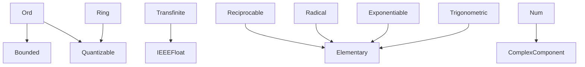
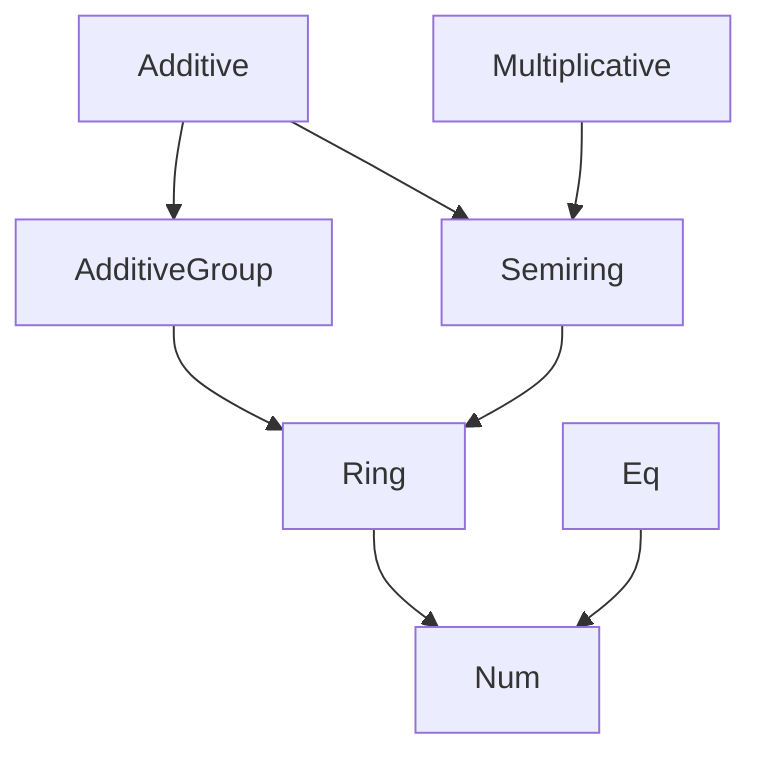
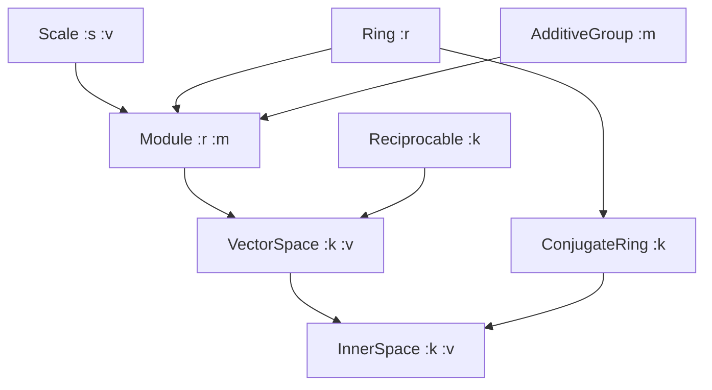
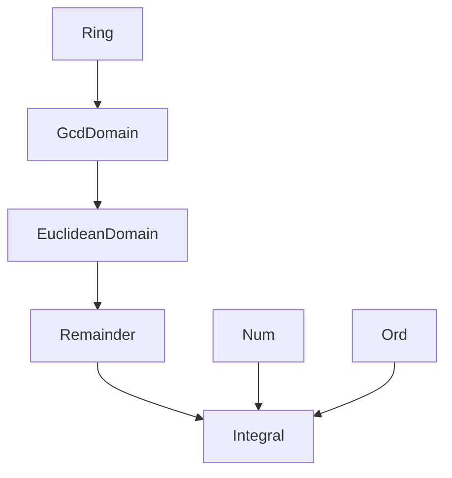

Coalton is statically typed and never performs implicit runtime coercion between
distinct numeric types, yet it supports overloaded numeric literals and fast
native arithmetic on machine types.

This article begins with a practical guide to everyday numbers and arithmetic in
Coalton, followed by a look at the algebraic type classes used for more advanced
mathematical programming.



## Concrete Number Types

Coalton's built-in number types are available in `coalton-prelude` and compile
directly to their underlying Common Lisp representations:

| Type | Description | Overflow / Range |
|---|---|---|
| `Integer` | Arbitrary-precision signed integer | Unbounded (fixnum when small) |
| `I8`, `I16`, `I32`, `I64` | Signed fixed-width integers | Signals an error on overflow |
| `IFix` | Signed machine-sized fixnum | Signals an error on overflow |
| `U8`, `U16`, `U32`, `U64` | Unsigned fixed-width integers | Wraps modulo $2^w$ |
| `UFix` | Unsigned machine-sized fixnum | Wraps |
| `Bit` | Single bit (`0` or `1`) | Wraps modulo $2$ (`+` is XOR, `*` is AND) |
| `Fraction` | Exact reduced ratio of `Integer`s | Unbounded |
| `F32` | IEEE 754 single-precision float | Supports `nan` and `infinity` |
| `F64` | IEEE 754 double-precision float | Supports `nan` and `infinity` |
| `Complex :a` | Complex number with `:a` components | Native `(cl:complex ...)` where supported |

### Literals and Conversions

Integer literals such as `0`, `1`, and `42` are overloaded: they can stand for
any numeric type (`Integer`, `I32`, `F64`, `Fraction`, etc.) as long as the
surrounding code determines which type is needed. When unconstrained by
context, integer literals default to `Integer`. To pin a literal to a specific
type, use [`the`](/manual/operators/the/):

```lisp
(the I32 42)
(the F64 10)
```

Rational literals use Common Lisp ratio syntax (`1/2`, `-3/4`) and always have
type `Fraction`. Floating-point literals follow Common Lisp exponent markers:
`1.0f0` (or `1.0` in standard readtable settings) is `F32`, and `1.0d0` is
`F64`.

Because Coalton does not implicitly cast variables at runtime, mixing variables
of different number types in `+` or `*` is a type error. Instead, convert
explicitly:

- [`as`](/manual/operators/as/) (or `into` from `Into :a :b`): infallible,
  lossless conversion (e.g., `(as Integer (the I32 5))`).
- [`try-as`](/manual/operators/try-as/) (or `try-into` from `TryInto :a :b`):
  checked conversion returning `Result String :b` (e.g., `I64` to `I16`).
- `integral->num` (in `coalton/math/integral`): converts any integer type into
  any numeric type.
- `inexact/` and `fromfrac` (in `coalton/math/real`): converts integer ratios
  or `Fraction`s to floating-point types.

Notice that an expression like `(+ 0.5d0 10)` *does* typecheck without a cast:
`0.5d0` fixes the expression's type to `F64`, so the literal `10` is understood
at compile time as `10.0d0`.

---

## Everyday Arithmetic

For ordinary numerical code, four type classes cover nearly every function
signature you will write:

| Goal | Operations | Class Constraint |
|---|---|---|
| Add, subtract, multiply, use integer literals, test `==` | `+`, `-`, `neg`, `*`, `zero`, `one`, `from-int`, `==` | `Num :a` |
| Divide or take reciprocals | `/`, `recip`, `^^` | `Reciprocable :a` |
| Integer quotients, remainders, parity, bit shifts | `quot`, `rem`, `quotrem`, `div`, `mod`, `divmod`, `to-integer`, `even?`, `odd?`, `lsh`, `rsh` | `Integral :a` |
| Compare values, take absolute values or extrema | `<`, `<=`, `>`, `>=`, `abs`, `min`, `max` | `Ord :a` |

### Negation and Subtraction

Because Coalton functions have fixed arity, `-` is strictly a two-argument
subtraction operator (`(- a b)` computes $a - b$). To negate a single number `x`,
use `(neg x)`:

```lisp
(coalton (neg 5))         ; => -5
(coalton (- 10 3))        ; => 7
```

### Division: `/`, `general/`, `quot`, and `div`

Coalton distinguishes three kinds of division:

1. **Same-type division (`/` and `recip` from `Reciprocable :a`):**
   Divides two values of type `:a` and returns a value of the same type `:a`
   (and `(recip x)` computes `(/ 1 x)`).
   This works on `Fraction`, `F32`, `F64`, and `Complex :a`:
   ```lisp
   (coalton (/ 1.0d0 4.0d0))        ; => 0.25d0
   (coalton (recip (the Fraction 4))) ; => 1/4
   ```
   `Integer` does *not* support `/`, because dividing two integers (like `1` and
   `4`) does not generally produce an integer.
2. **Type-changing division (`general/` from `Dividable :arg :res`):**
   Divides two values of one type to produce a result of another type. For
   instance, `(Dividable Integer Fraction)` lets you divide two `Integer`s to
   get a `Fraction` (or use `exact/` from `coalton/math/real`, which is
   specialized to `Integer * Integer -> Fraction`).
3. **Integer division with remainder (`quot`/`rem` and `div`/`mod`):**
   For integer types (`Integral :a`), you can compute an integer quotient and
   remainder in two ways:
   - `quot` and `rem` truncate the quotient toward zero (matching Common Lisp
     `cl:truncate` and `cl:rem`).
   - `div` and `mod` floor the quotient toward negative infinity (matching
     Common Lisp `cl:floor` and `cl:mod`).
   - `quotrem` and `divmod` return both the quotient and remainder at once as
     multiple values:
     ```lisp
     (let (values q r) = (quotrem -17 5))
     ;; q = -3, r = -2
     (let (values d m) = (divmod -17 5))
     ;; d = -4, m = 3
     ```

### Exponentiation: `^`, `^^`, and `pow`

Coalton provides three exponentiation functions depending on what kind of
exponent you have:

- `(^ base power)`: Raises `base` to a non-negative integer `power` (e.g.,
  `(^ 2 10)` is `1024`, and `(^ 1.5d0 3)` is `3.375d0`).
- `(^^ base power)`: Raises a `Reciprocable` `base` (such as a `Fraction` or
  `F64`) to a signed integer `power`, allowing negative exponents (e.g.,
  `(^^ (the Fraction 2) -3)` is `1/8`).
- `(pow x y)`: Raises `x` to a non-integer power `y` of the same type (e.g.,
  `(pow 2.0d0 0.5d0)`).

### Rounding, Elementary Functions, and Complex Numbers



#### Bounds and Infinities (`coalton/math/bounded`, `coalton/math/arith`)

Fixed-width integers have finite minimum and maximum values, while floating-point
and extended number systems represent infinite and indeterminate values:

- **`Bounded :a`**: types with minimum and maximum bounds (`min-bound`, `max-bound`).
- **`Transfinite :a`**: types with an infinity representation (`infinity`, `negative-infinity`, `infinite?`, `finite?`).
- **`IEEEFloat :a`**: floating-point types supporting IEEE 754 Not-a-Number (`nan`, `nan?`).

#### Rounding and Approximation (`coalton/math/real`)

Real-valued types can be rounded to nearby integers or approximated to a chosen
number of binary digits in another numeric representation:

- **`Quantizable :a`**: ordered rings whose elements lie between consecutive integers and support rounding to `Integer` (e.g., `floor`, `ceiling`, `truncate`, `round`).
- **`Approximable :a :b`**: approximating a value `x` to within $2^{-\mathtt{bits}}$ in target type `:b` via `(approx bits x)`.

#### Roots, Exponentials, and Trigonometry (`coalton/math/elementary`)

Elementary transcendental and algebraic functions are grouped by capability so
that types like polynomials, power series, or real algebraic numbers can
implement the subset they support:

- **`Radical :a`**: square roots and $n$th roots (`sqrt`, `nth-root`).
- **`Exponentiable :a`**: exponentials, logarithms, and hyperbolic functions (e.g., `exp`, `ln`, `pow`, `sinh`, `cosh`).
- **`Trigonometric :a`**: trigonometric and inverse trigonometric functions (e.g., `sin`, `cos`, `tan`, `atan`).
- **`Polar :a`**: polar coordinate conversions (`magnitude`, `phase`, `polar`, `cis`).
- **`Elementary :a`**: mathematical constants `pi` ($\pi$) and `ee` ($e$) on types supporting all elementary operations.

#### Complex Numbers (`coalton/math/complex`)

Any numeric type implementing `ComplexComponent` can serve as the real and
imaginary parts of `(Complex :a)` (using specialized native Common Lisp complex
representations where available):

- **`ComplexComponent :a`**: types that can form `Complex :a` numbers (constructed with `complex`, destructured with `real-part` and `imag-part`, with imaginary unit `ii`).

---

## Defining Your Own Number Type

You can always implement each algebraic type class in a fine-grained way using
`define-instance` (see [The Algebraic Class Hierarchy](#the-algebraic-class-hierarchy)
below). However, Coalton provides a simple macro, `define-num` (from
`coalton/classes`), for defining routine numerical types that don't need so much
control.

You provide `+`, `-`, `*`, and `from-int` (how to convert an `Integer` into your
type). If you don't specify `zero`, `one`, or `neg`, `define-num` defines
them automatically from `from-int` and `-`:

```lisp
(coalton-toplevel
  (derive Eq)
  (repr :transparent)
  (define-type Mod7
    (Mod7 Integer))

  (declare mod7 (Integer -> Mod7))
  (define (mod7 n)
    (Mod7 (coalton/math:mod n 7)))

  (define-num Mod7
    (define (+ (Mod7 a) (Mod7 b)) (mod7 (+ a b)))
    (define (- (Mod7 a) (Mod7 b)) (mod7 (- a b)))
    (define (* (Mod7 a) (Mod7 b)) (mod7 (* a b)))
    (define (from-int n)           (mod7 n))))
```

If your type has a more direct way to construct `zero` or `one` or to compute
`neg`, you can include `(define zero ...)`, `(define one ...)`, or
`(define (neg x) ...)` inside the `define-num` form as well.

---

## The Algebraic Class Hierarchy

> [!NOTE]
> This section covers slightly more advanced mathematics, drawing primarily on
> concepts from abstract algebra (such as groups, semirings, rings, modules, and
> integral domains). If you are only writing everyday numerical code, the classes
> in [Everyday Arithmetic](#everyday-arithmetic) and `define-num` above are all
> you need.

When writing generic mathematical code—or implementing types like vectors,
matrices, tropical weights, or polynomials that are *not* full rings with
equality—you can constrain functions to the exact algebraic structure they need.

Most of these numerical and algebraic classes carry mathematical laws
(associativity, identity, inverse, distributivity, and so on) that generic
algorithms rely on. When implementing instances for your own types, your
implementations should respect the laws outlined in each class's documentation
in the [Standard Library Reference](/reference/).

### Additive and Multiplicative Classes (`coalton/classes`)



| Class | Methods | Typical Examples |
|---|---|---|
| `Additive :a` | `+`, `zero` | Numbers, vectors, matrices, polynomials |
| `AdditiveGroup :a` | `-`, `neg` | Displacements, vectors, signed numbers |
| `Multiplicative :a` | `*`, `one` | Numbers, square matrices, endomorphisms |
| `Semiring :a` | — | Natural numbers, tropical $(\min, +)$ semiring, polynomials over a semiring |
| `Ring :a` | `from-int` | Integers, matrices, computable reals (`CReal`), formal power series |
| `Num :a` | — | `Integer`, `Fraction`, `F32`, `F64`, `Complex :a`, `Polynomial :a` |

For instance, a 2D vector type only needs `Additive` and `AdditiveGroup` to
support `+`, `-`, `neg`, and `list:sum`—without defining a bogus vector-vector
`*` or `from-int`:

```lisp
(coalton-toplevel
  (derive Eq)
  (define-struct Vec2
    (x F64)
    (y F64))

  (define-instance (Additive Vec2)
    (define (+ (Vec2 x1 y1) (Vec2 x2 y2))
      (Vec2 (+ x1 x2) (+ y1 y2)))
    (define zero (Vec2 0.0d0 0.0d0)))

  (define-instance (AdditiveGroup Vec2)
    (define (- (Vec2 x1 y1) (Vec2 x2 y2))
      (Vec2 (- x1 x2) (- y1 y2)))
    (define (neg (Vec2 x y))
      (Vec2 (neg x) (neg y)))))
```

### Conjugation, Modules, and Inner-Product Spaces (`coalton/math/arith`)

Linear structures where a scalar `:s` acts on a vector or module element `:v`
are expressed with multi-parameter classes in `coalton/math/arith`:



- **`ConjugateRing :a`**:
  A ring with an involutive anti-automorphism `(conjugate x)` (a $\ast$-ring or
  "star ring"). On real types, `conjugate` is the identity; on `Complex :a`,
  it maps $a + bi \mapsto a - bi$.
- **`Scale :s :v`**:
  Left scaling `(scale c v)` of `:v` by `:s`.
- **`Module :r :m`**:
  A module `:m` over a ring `:r`.
- **`VectorSpace :k :v (:v -> :k)`**:
  A module over a division ring or field `:k`, with a functional dependency
  `:v -> :k` so the scalar field is uniquely determined by the vector type.
- **`InnerSpace :k :v (:v -> :k)`**:
  Provides `(inner-product x y)`, obeying conjugate symmetry
  $\langle x, y \rangle = \overline{\langle y, x \rangle}$ so both real
  dot products and complex Hermitian inner products share a single interface.

Continuing our `Vec2` example above, we can make `Vec2` an `InnerSpace` over
`F64`:

```lisp
(coalton-toplevel
  (define-instance (math:Scale F64 Vec2)
    (define (math:scale k (Vec2 x y))
      (Vec2 (* k x) (* k y))))

  (define-instance (math:Module F64 Vec2))
  (define-instance (math:VectorSpace F64 Vec2))

  (define-instance (math:InnerSpace F64 Vec2)
    (define (math:inner-product (Vec2 x1 y1) (Vec2 x2 y2))
      (+ (* x1 x2) (* y1 y2)))))
```

### GCD Domains, Euclidean Domains, and Integers (`coalton/math/integral`)

`coalton/math/integral` organizes integral domains and integers into four levels:



- **`GcdDomain :a`**:
  Provides canonical unit decomposition `x == (* (unit-part x) (normal-part x))`,
  exact division `(exact-quot a b)` returning `Optional :a` (plus `(exact-div a b)`),
  and greatest common divisor `(gcd a b)` (plus derived `(lcm a b)`).
  - For `Integer`, `unit-part` is the sign ($\pm 1$) and `normal-part` is `abs`.
  - For Gaussian integers `Complex Integer`, `normal-part` rotates nonzero
    elements into the first quadrant $\{a + bi : a > 0, b \ge 0\}$.
  - For polynomials `Polynomial :a` over any `GcdDomain :a`, `normal-part`
    unit-normalizes the leading coefficient (making polynomials over a field
    monic, and polynomials over `Integer` have positive leading coefficient),
    and `gcd` uses Gauss's lemma and primitive pseudo-remainder sequences.
- **`EuclideanDomain :a`**:
  Adds a degree/norm measure `(euclidean-degree x)` returning `Integer` and
  Euclidean division with remainder (`quotrem`, `quot`, `rem`). Enables
  `(extended-gcd a b)`, which returns `(values g s t)` satisfying Bézout's
  identity $g = \gcd(a, b) = sa + tb$. Implemented by `Integer`, fixed-width
  integers, `Complex Integer`, and `Polynomial :k` over any field `:k`.
- **`Remainder :a`**:
  Adds floored division (`div`, `mod`, `divmod`).
- **`Integral :int`**:
  Ordered integer types that convert to `Integer` via `to-integer`.

---

## Extended Mathematics (`coalton/xmath`)

For applications in scientific computing, symbolic algebra, automatic
differentiation, and exact geometry, load the `"coalton/xmath"` ASDF system:

```lisp
(ql:quickload "coalton/xmath")
```

`coalton/xmath` provides:

- **`coalton/xmath/polynomial`**: Univariate and recursive multivariate
  polynomials ($R[x]$ and $R[x][y]\cdots$), including polynomial GCDs,
  resultants, and square-free factorization.
- **`coalton/xmath/ratio`**: Reduced fractions over any GCD domain (such as
  rational functions $p(x)/q(x)$ and Gaussian rationals), along with partial
  fraction decomposition and Hermite reduction for symbolic rational integration.
- **`coalton/xmath/power-series`**: Lazy formal power series
  $\sum_{n=0}^{\infty} a_n x^n$ with algebraic, transcendental, and calculus
  operations, composition, and Lagrange series reversion.
- **`coalton/xmath/matrix`**: Dense matrices over semirings, rings, GCD domains,
  and fields, supporting fraction-free determinants and characteristic
  polynomials, linear system solving, and Gram–Schmidt orthogonalization.
- **`coalton/xmath/differential`**: Differential rings, Wronskians, linear
  differential operators $A[\partial; \, '\,]$, and power-series solutions of
  linear ordinary differential equations.
- **`coalton/xmath/groebner`**: Sparse multivariate polynomials under standard
  monomial orderings and Buchberger's algorithm for reduced Gröbner bases.
- **`coalton/xmath/modular`**: Modular arithmetic, the Chinese Remainder Theorem
  over Euclidean domains, and Lagrange polynomial interpolation.
- **`coalton/xmath/integer-factorization`**: [Integer factorization and primality](#integer-factorization-and-primality)
  with distinct results for proofs and probable primes.
- **`coalton/xmath/recurrence`**: Padé rational approximants, Berlekamp–Massey
  recurrence synthesis, fast linear recurrence evaluation, difference calculus,
  and Gosper's algorithm for indefinite hypergeometric summation.
- **`coalton/xmath/quaternion`**: Hamilton's quaternions
  $w + x\mathbf{i} + y\mathbf{j} + z\mathbf{k}$ and 3D spatial rotations.
- **`coalton/xmath/clifford-algebra`**: Graded Clifford (geometric) algebras
  $\text{Cl}(p, q, r)$ with exterior, contraction, geometric, and sandwich
  products.
- **`coalton/xmath/real-algebraic`**: Exact real algebraic numbers represented by
  defining polynomials and certified isolating intervals.
- **`coalton/xmath/dual`** and **`coalton/xmath/hyperdual`**: First- and
  second-order forward-mode automatic differentiation.
- **`coalton/xmath/big-float`**, **`coalton/xmath/dyadic`**, and
  **`coalton/xmath/computable-reals`**: Arbitrary-precision floating-point,
  dyadic rationals $m \cdot 2^k$, and constructive real arithmetic.
- **`coalton/xmath/fft`**: Fast Fourier transforms over rings with roots of
  unity.

### Integer factorization and primality

With `ifact` as a local nickname for `coalton/xmath/integer-factorization`:

```lisp
(coalton (ifact:factor-integer-exact -360))
;; => (Some (Factorization -1 [(Tuple 2 3) (Tuple 3 2) (Tuple 5 1)]))

(coalton (ifact:factor-integer 3127 :rho-steps 0))
;; => (PartialFactorization (Factorization 1 []) 3127)
```

The first result represents $-2^3 \cdot 3^2 \cdot 5$. Only **proved** primes
appear in the list, sorted and paired with their multiplicities. Both units
have empty lists. Zero has no finite prime factorization: `factor-integer`
returns `ZeroFactorization` and `factor-integer-exact` returns `None`.

Use `factor-integer` when an unfinished answer is preferable to a long
exhaustive search. It strips small factors, detects exact powers, and uses
Brent's batched Pollard rho with restarts to split composites. `:rho-steps`
limits polynomial evaluations across the entire factorization (default $2^{20}$),
not the time spent on primality or perfect powers. A `PartialFactorization`
preserves the input: multiply its signed proved part by its unresolved
cofactor. That cofactor is **not** known to be prime. `factor-integer-exact`
can finish by trying divisors through the square root; on large inputs this
may be impractical.

For primality alone, `primality` returns `CompositeOrUnit` for nonprimes it
can identify (including all $n<2$). Its Miller–Rabin results are exact below
[the first strong pseudoprime to the first thirteen prime bases](https://doi.org/10.1090/mcom/3134),
$3317044064679887385961981$. Beyond that range a witness can still disprove
primality, and Proth's theorem can prove some primes. Otherwise, passing the
fixed bases yields only `ProbablePrime`; it carries no randomized error bound.
When constructing a field, accept only `ProvenPrime`.
